# Modelo relacional — etapa 3

Este é o desenho do banco, não uma declaração de tabelas já criadas. A conexão é
da etapa 4 e o mapeamento SQLAlchemy e as migrações iniciais são da etapa 5.

## Entidades e justificativa

Categoria, Produto, Mesa, Garcom e Pedido são as cinco entidades principais.
ItemPedido é a associação entre pedido e produto com quantidade/preço próprios.
FechamentoConta guarda o encerramento financeiro de um pedido. As sete entidades
correspondem ao cardápio e ao fluxo de atendimento descritos no tema.

## Diagrama

```mermaid
erDiagram
    CATEGORIA ||--o{ PRODUTO : organiza
    MESA |o--o{ PEDIDO : recebe
    GARCOM ||--o{ PEDIDO : registra
    PEDIDO ||--o{ ITEM_PEDIDO : contem
    PRODUTO ||--o{ ITEM_PEDIDO : aparece_em
    PEDIDO ||--o| FECHAMENTO_CONTA : possui

    CATEGORIA {
        int id PK
        string nome UK
        string descricao
        boolean ativa
    }
    PRODUTO {
        int id PK
        int categoria_id FK
        string nome
        string descricao
        bigint preco_centavos
        boolean disponivel
        boolean ativo
    }
    MESA {
        int id PK
        int numero UK
        int capacidade
        boolean ativa
    }
    GARCOM {
        int id PK
        string codigo UK
        string nome
        boolean ativo
    }
    PEDIDO {
        int id PK
        int mesa_id FK "opcional na retirada"
        int garcom_id FK
        string modalidade
        string situacao
        datetime criado_em
        datetime cancelado_em "opcional"
    }
    ITEM_PEDIDO {
        int id PK
        int pedido_id FK
        int produto_id FK
        int quantidade
        bigint preco_unitario_centavos
        string situacao
        datetime criado_em
    }
    FECHAMENTO_CONTA {
        int id PK
        int pedido_id FK, UK
        bigint total_centavos
        datetime fechado_em
    }
```

O pedido pode ter zero itens ao ser aberto, mas só é finalizado com pelo menos um.
Uma mesa pode receber vários pedidos ao longo do tempo. Um pedido possui zero ou
uma mesa; a regra de modalidade torna esse vínculo obrigatório em MESA e ausente
em RETIRADA. O fechamento é opcional durante o atendimento e obrigatório quando
o pedido se torna FINALIZADO.

## Convenções

- PK: chave primária inteira gerada pelo banco.
- FK: chave estrangeira para outra entidade.
- UK: unicidade garantida no banco.
- Todos os campos são obrigatórios, salvo os explicitamente opcionais.
- Textos obrigatórios devem ser aparados e não vazios na entrada.
- Campos de situação são textos limitados aos valores dos enums, com CHECK no banco;
  não dependem de um tipo ENUM exclusivo do PostgreSQL.
- Datas representam instantes em UTC. A camada de banco tratará a diferença de
  representação entre PostgreSQL e SQLite sem alterar as entidades/routers.
- Preços e totais são inteiros de 64 bits em centavos. Python usa int para os cálculos.
  Entradas e resultados também precisarão respeitar os limites da coluna.

## Dicionário de dados

| Tabela | Campo | Tipo lógico | Restrição/uso |
|---|---|---|---|
| categorias | id | inteiro | PK. |
| categorias | nome | texto até 80 | Obrigatório e único. |
| categorias | descricao | texto | Opcional. |
| categorias | ativa | booleano | Padrão verdadeiro; controla novas inclusões. |
| produtos | id | inteiro | PK. |
| produtos | categoria_id | inteiro | FK categorias.id. |
| produtos | nome | texto até 120 | Obrigatório. |
| produtos | descricao | texto | Obrigatório, conforme identificação do produto no tema. |
| produtos | preco_centavos | inteiro de 64 bits | CHECK >= 0; preço atual do cardápio. |
| produtos | disponivel | booleano | Padrão verdadeiro; indisponibilidade temporária. |
| produtos | ativo | booleano | Padrão verdadeiro; desativação do cadastro sem apagar histórico. |
| mesas | id | inteiro | PK. |
| mesas | numero | inteiro | UNIQUE e CHECK > 0. |
| mesas | capacidade | inteiro | CHECK > 0. |
| mesas | ativa | booleano | Padrão verdadeiro; não representa ocupação. |
| garcons | id | inteiro | PK. |
| garcons | codigo | texto até 30 | Obrigatório e único; identificação de trabalho. |
| garcons | nome | texto até 120 | Obrigatório. |
| garcons | ativo | booleano | Padrão verdadeiro. |
| pedidos | id | inteiro | PK. |
| pedidos | mesa_id | inteiro | FK mesas.id; nulo somente em RETIRADA. |
| pedidos | garcom_id | inteiro | FK garcons.id; obrigatório nas duas modalidades por decisão do projeto. |
| pedidos | modalidade | texto | CHECK IN ('MESA', 'RETIRADA'). |
| pedidos | situacao | texto | CHECK IN ('ABERTO', 'FINALIZADO', 'CANCELADO'); padrão ABERTO. |
| pedidos | criado_em | data/hora | Gerado pelo servidor. |
| pedidos | cancelado_em | data/hora | Opcional; preenchido apenas no cancelamento. |
| itens_pedido | id | inteiro | PK; cada inclusão cria uma linha própria. |
| itens_pedido | pedido_id | inteiro | FK pedidos.id. |
| itens_pedido | produto_id | inteiro | FK produtos.id. |
| itens_pedido | quantidade | inteiro | CHECK > 0. |
| itens_pedido | preco_unitario_centavos | inteiro de 64 bits | CHECK >= 0; capturado na inclusão; imutável. |
| itens_pedido | situacao | texto | CHECK IN ('PENDENTE', 'EM_PREPARO', 'PRONTO'); padrão PENDENTE. |
| itens_pedido | criado_em | data/hora | Gerado pelo servidor. |
| fechamentos_conta | id | inteiro | PK. |
| fechamentos_conta | pedido_id | inteiro | FK pedidos.id e UNIQUE: no máximo um fechamento por pedido. |
| fechamentos_conta | total_centavos | inteiro de 64 bits | CHECK >= 0; calculado pelo servidor. |
| fechamentos_conta | fechado_em | data/hora | Gerado pelo servidor. |

Não haverá UNIQUE(pedido_id, produto_id): o mesmo produto pode ser acrescentado
mais tarde com preço ou preparo diferente. Nomes de produtos não são artificialmente
únicos; códigos de garçom, número de mesa e nomes de categoria são identificadores
com unicidade definida. Inicialmente, nomes de categoria são únicos conforme a
comparação textual padrão do banco; não se promete comparação sem acentos/case.

## Restrições adicionais e transações

1. CHECK de modalidade/mesa: MESA exige mesa_id não nulo; RETIRADA exige mesa_id nulo.
2. CHECK de cancelamento: cancelado_em deve ser preenchido em CANCELADO e nulo nos
   outros estados; a data não pode ser anterior à criação.
3. Índice único parcial em pedidos(mesa_id), somente quando situacao = 'ABERTO'
   e mesa_id não é nulo. Ele impede dois pedidos abertos da mesma mesa inclusive
   em concorrência, sem impedir novos atendimentos após o encerramento.
4. FKs preservam as referências históricas. Não será utilizado CASCADE para apagar
   vendas ao excluir produto, categoria, garçom ou mesa. A API desativa ou rejeita
   a exclusão conforme dependências.
5. A exigência de um fechamento para cada pedido FINALIZADO envolve duas tabelas:
   será garantida pelo serviço transacional, além do UNIQUE no fechamento. Não se
   presume que uma FK simples imponha essa condição nos dois sentidos.
6. Fechar conta cria fechamento e altera a situação do pedido na mesma transação.
   Falha de qualquer parte exige rollback. A mesma coordenação deve impedir alteração
   concorrente de itens durante o fechamento.
7. O total aberto é calculado a partir dos itens; não haverá uma coluna de total
   aberto mantida manualmente. Ao finalizar, o valor é consolidado no fechamento.
8. Ocupação da mesa é derivada dos pedidos ABERTOS; não haverá um booleano separado
   que possa ficar desatualizado. `ativa` significa habilitada para uso.

Índices parciais únicos são suportados pelos dois bancos planejados; os argumentos
específicos dos dialetos serão tratados no mapeamento e nas migrações, mantendo o
mesmo modelo para as duas configurações. Referências técnicas:
[PostgreSQL — CREATE INDEX](https://www.postgresql.org/docs/current/sql-createindex.html)
e [SQLite — Partial Indexes](https://www.sqlite.org/partialindex.html).

## Evolução planejada para F14

O esquema inicial não terá o campo observacao em pedidos. Após seu uso com dados,
uma nova versão Alembic acrescentará esse campo opcional preservando os registros.
Essa evolução real será a etapa 13; nada será apagado/recriado para simular migração.
