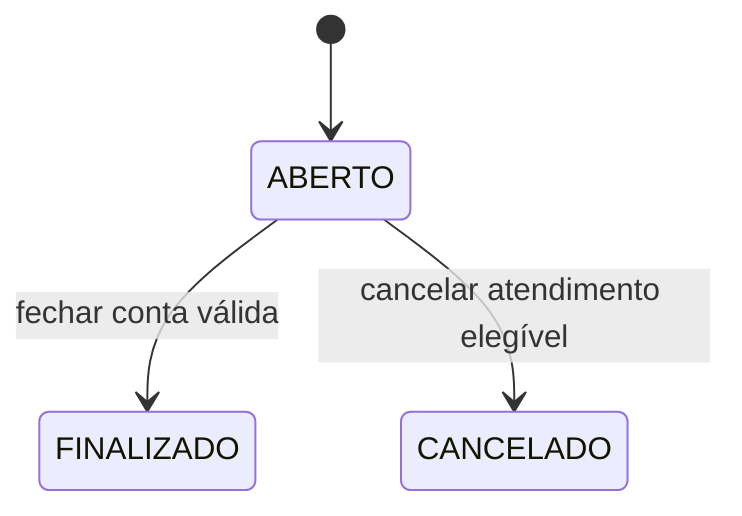

# Regras de negócio — Tema 8

Estado: regras definidas nas etapas 2 e 3; aplicação nas operações pendente das
etapas 7 a 9. Definir enums ou documentar regras não conclui F13 nem F17.

## Como deduzimos as regras

O tema descreve comandas, cardápio, preços, preparo, mesas, retirada e fechamento.
As entidades e as regras foram deduzidas dessas necessidades. Onde o tema permite
interpretação, as decisões abaixo são escolhas do projeto, não instruções literais
do professor.

## Estados e transições escolhidos

Pedido nasce ABERTO e pode ir para FINALIZADO ou CANCELADO. Esses estados são finais;
não haverá reabertura no escopo inicial.

Item nasce PENDENTE e pode seguir PENDENTE → EM_PREPARO → PRONTO. Não se retrocede
o preparo. Somente itens de pedidos ABERTOS podem avançar de estado.

Modalidades: MESA ou RETIRADA. O cadastro Garcom identifica o responsável pelo
registro/atendimento em ambas as modalidades; essa obrigatoriedade é uma escolha
para manter rastreabilidade também na retirada.

## Regras e critérios de aceitação

| ID | Regra definida | Origem | Exemplo de verificação futura |
|---|---|---|---|
| RN01 | Pedido de MESA exige mesa existente e ativa; RETIRADA não possui mesa. | Tema e decisão de representação. | Rejeitar MESA sem mesa e RETIRADA com mesa; aceitar retirada sem mesa. |
| RN02 | Todo novo pedido exige garçom existente e ativo. | Garçons presentes no tema; obrigatoriedade nas duas modalidades é decisão do projeto. | Rejeitar responsável desativado sem alterar o histórico de seus pedidos antigos. |
| RN03 | Uma mesa só pode ter um pedido ABERTO por vez. | Interpretação escolhida para impedir atendimentos simultâneos incompatíveis. | Duas tentativas concorrentes para a mesma mesa não podem criar dois pedidos abertos. |
| RN04 | Categoria ativa e produto ativo/disponível são necessários para adicionar um novo item. | Disponibilidade exigida; separação entre ativo e disponível é decisão do projeto. | Desativar produto preserva vendas antigas e bloqueia novas inclusões. |
| RN05 | A quantidade do item é inteira e maior que zero. | Quantidades de produtos do tema. | Rejeitar quantidade zero, negativa ou fracionária. |
| RN06 | O preço unitário é capturado do produto no momento da inclusão. O cliente não escolhe o preço aplicado. | Preservação do valor da venda exigida no tema. | Adicionar por R$ 25,00, mudar o cardápio para R$ 30,00 e manter o item anterior por R$ 25,00. |
| RN07 | Cada inclusão gera uma linha; o mesmo produto pode aparecer mais de uma vez com preços ou estados diferentes. | Decisão para permitir acréscimos sem alterar linhas anteriores. | Acrescentar o mesmo produto após mudança de preço preserva as duas linhas e seus preços. |
| RN08 | Acrescentar itens, alterar quantidade e remover itens exige pedido ABERTO. Alteração/remoção de linha exige item PENDENTE. | Atualizações durante atendimento e limites de preparo do tema; política exata é decisão do projeto. | Rejeitar remoção de item EM_PREPARO e atualização de pedido FINALIZADO. |
| RN09 | O total é calculado pelo servidor como soma de quantidade × preço unitário aplicado. | Necessidade central do tema. | Duas unidades de R$ 25,00 e três de R$ 8,00 totalizam R$ 74,00. |
| RN10 | Dinheiro é representado por centavos inteiros; preços e totais não podem ser negativos. | Decisão técnica para exatidão e portabilidade. | R$ 8,90 é armazenado como 890; o cálculo não utiliza float. |
| RN11 | Só é possível finalizar pedido ABERTO com pelo menos um item. O fechamento é único e criado com o total calculado na mesma transação. | Fechamento consistente do tema e definição do fluxo. | Segunda tentativa de fechar retorna conflito e não cria outro fechamento. |
| RN12 | FINALIZADO e CANCELADO bloqueiam novas alterações. Não há edição nem exclusão genérica de fechamentos financeiros. | Consistência após fechamento; bloqueio de cancelados é decisão do projeto. | Mudar preço no cardápio ou enviar total arbitrário não altera o fechamento anterior. |
| RN13 | Cancelamento é permitido somente para pedido ABERTO cujos itens ainda estejam PENDENTES; pedido vazio também pode ser cancelado. | O tema exige considerar cancelamento; esta é a política escolhida. | Cancelar pedido com item EM_PREPARO é rejeitado; o pedido e sua ocupação continuam válidos. |
| RN14 | Finalizar/cancelar validamente libera a mesa sem excluir o pedido. A ocupação é derivada da existência de pedido ABERTO. | Ocupação e liberação previstas no tema. | Após encerrar o primeiro pedido, a mesa aceita outro e mantém o histórico. |
| RN15 | Cadastros referenciados são desativados; pedidos finalizados/cancelados e seus itens não são apagados. | Preservação do histórico e F5. | Desativar produto ou garçom não remove itens nem pedidos anteriores. |
| RN16 | Faturamento e ranking de vendas consideram apenas pedidos FINALIZADOS. | Definição de venda/faturamento do projeto. | Cancelamentos e contas abertas não entram na receita ou no ranking. |

## Decisões complementares

- Finalização não exige que todos os itens estejam PRONTOS, pois o tema não impõe
  essa condição e retirada pode ter pagamento antecipado. Preparação e situação
  financeira são conceitos separados; finalizar encerra a edição do pedido.
- Desativar uma mesa, categoria ou garçom com atendimento aberto dependente será
  bloqueado até seu encerramento. Produto pode ficar indisponível para novas
  inclusões sem remover os itens já registrados.
- Exclusão física de cadastros só será admitida quando não houver dependências;
  desativação será o comportamento preferencial documentado da API.
- A API não inclui estoque, taxa de serviço, descontos, entregas, pagamento dividido,
  autenticação ou cadastro nominal de clientes no escopo inicial. São funcionalidades
  que não constam como exigências no material recebido.
- Alterar quantidade de uma linha PENDENTE mantém o preço capturado dessa linha.
  Uma nova inclusão do produto captura o preço atual e gera outra linha.

## Operações planejadas

Abrir pedido; adicionar item; alterar quantidade; remover item pendente; iniciar
preparo; marcar pronto; consultar conta; finalizar; cancelar. Os nomes exatos das
rotas serão definidos ao implementar os routers. As transações devem impedir
mudanças parciais, por exemplo, fechamento criado sem pedido finalizado.

Erros de regras serão apresentados com mensagens claras e códigos adequados,
normalmente 409 para conflito de estado/disponibilidade. Recursos inexistentes
retornam 404; entradas inválidas, 400 ou 422 conforme sua natureza.
